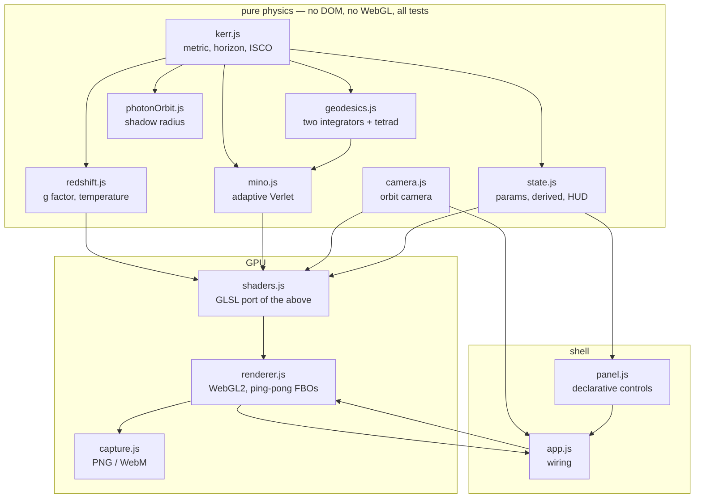
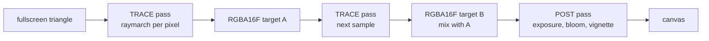

# Architecture

## The one rule that shapes everything

**The physics lives in tested JavaScript, and the shader is a port of it.**

Every formula in the GLSL has a counterpart in `src/core/` with a test asserting
the same number. This is not a stylistic preference — a ray tracer's failure
mode is an image that looks *plausible*. A wrong redshift sign, a mis-signed
Carter constant, or a non-orthonormal camera basis all produce images that a
human would describe as "a black hole with a disk" while being quantitatively
wrong. Staring at the image cannot distinguish those cases. Running a test can.

The rule is enforced mechanically by `tests/shaderParity.test.js`, which reads
the shader source as text and asserts that each formula with a tested JS
counterpart appears in the same algebraic form. Without that enforcement the two
drift, and the drift is silent: the shader once computed the retrograde orbital
velocity with the prograde denominator, and no physics test or visual check
caught it, because at $a = 0$ the two agree.

## Layers

`src/core/` has no imports from `src/gl/` or `src/ui/`, in either direction.
That is what lets the entire physics surface be tested in Node with no browser,
no canvas, and no GPU.

## Why two geodesic integrators

`geodesics.js` integrates null geodesics twice, by methods that share no algebra:

| | `integrateHamilton` | `integrateCarter` / `mino.js` |
| --- | --- | --- |
| Needs | inverse metric + finite-differenced derivatives | constants of motion $E, L_z, Q$ |
| Derivation | none — direct from the metric | Carter separation, hand-derived |
| Parameter | affine $\lambda$ | Mino time $\lambda_M$, $d\lambda = \Sigma\, d\lambda_M$ |
| Horizon | coordinate-singular, needs a stage guard | regular, crossed freely |
| Speed | slow | fast |
| Role | reference / arbiter | what the shader ports |

Because they share no algebra, a sign error or a wrong Carter constant makes
them **disagree immediately** rather than silently producing a plausible image.
`tests/geodesics.test.js` asserts they agree to $10^{-3}$ on closest approach and
$5\times10^{-3}$ on the disk-crossing events the renderer reads. Had there been
one integrator, every bug in it would have been a bug in the tests too.

### The horizon is a coordinate singularity, and it bites the reference only

Boyer–Lindquist coordinates are singular at $r_+$: $\Delta$ changes sign and
$g^{tt}$, $g^{t\varphi}$, $g^{\varphi\varphi}$ all carry $\Delta$ in the
denominator, so they diverge. An infalling ray is perfectly regular and
$dr/d\lambda$ stays finite there, but $p_r$ diverges — so a fixed RK4 step can
evaluate its *later stages* below $r_+$, and the resulting spurious
$dp_r/d\lambda$ corrupts the accepted step.

Measured before the guard: at $a=0$, $b=4$, step $0.02$, the step from
$r = 2.001125$ evaluated its fourth stage at $r = 1.9837$ and landed at
$r = 9.37$, then at $r = -1.93\times10^{9}$. `stepHorizonSafe` rejects and
halves any step whose stages reach $r_+$. Escaping rays never trip the test, so
the guard costs four `Math.min` calls and no extra derivative evaluations.

Two details are easy to get wrong and were:

- The guard must be $r_+$ itself, never the larger termination radius
  $r_+ + 10^{-3}$. Guarding above the singularity but below the termination test
  is a Zeno trap: the accepted decrement eventually falls under one ulp of $r$
  and the ray freezes just above the guard without ever satisfying it.
- The *accepted* step must still be allowed to cross the termination radius —
  that is how capture is detected. Only the stages need protection.

The Mino-time integrators are immune by construction: $dr/d\lambda_M = \sqrt{R}$
is finite and nonzero at the horizon, so they step through it cleanly. That
asymmetry is why a captured ray's `rPeri` is only meaningful as a proximity
check, not as a shared observable between the two families.

## The render pipeline

Two RGBA16F targets ping-pong. The trace pass reads the previous accumulation
and writes `mix(prev, color, 1/(n+1))`, so the running average is maintained on
the GPU and never round-trips through the CPU. The frame count is stored in the
alpha channel, which is why the targets are float and NEAREST-filtered — a
half-float accumulation buffer would lose the sample count and smear the
average.

Keeping the accumulation in HDR and applying exposure, bloom, and vignette only
in the post pass is what makes those three knobs free: they do not invalidate
accumulated history, so adjusting brightness while an image settles costs
nothing. Anything that changes the *traced* scene does reset it.

## Progressive accumulation and the lazy loop

The render loop traces a frame only when something changed or accumulation is
still improving. An idle tab costs zero GPU. This matters because the photon
ring — the thin bright line at the shadow's edge — is a feature a few pixels
wide whose light has orbited the hole several times. A single sample cannot
resolve it; it appears only as the average converges.

## The panel is data

`panel.js` declares a `LAYOUT` array of field descriptors. Each knows how to
read and write one key of `params`, and each declares whether changing it
invalidates accumulated history (`physics: true`) or only affects the post pass.
`sync()` is the only path by which the DOM can disagree with the simulation: the
wheel and keyboard handlers mutate the camera, then call `sync()`. There is no
second copy of the state and therefore no way for a slider to drift.

## Diagnostics

`scripts/measureBeaming.js` prints the redshift factor across the disk for a
given spin, which is how the display gain was chosen rather than guessed. The
browser exposes `window.kerr` for live probing.

## Deliberate omissions

- **No build step, no dependencies.** ES modules load directly; the dev server
  is 73 lines of Node with no packages. A simulation this self-contained should
  not require a toolchain to read.
- **No ECS, no scene graph, no material system.** The whole frame is two draw
  calls: one fullscreen triangle for the trace pass, one for the post pass.
  Abstractions that pay for themselves with many object types are a pure cost
  with two.
- **No LLM, no heuristics, no tuned fudge factors in the physics.** Every
  quantity in `src/core/` is derived. The one non-physical constant is the
  display gain, and it is commented as such and kept out of the physics modules.
